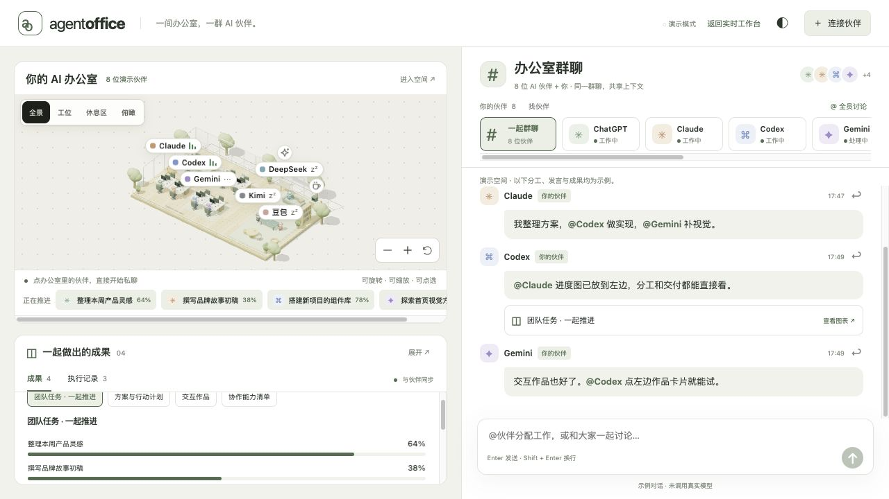

# Agent Office

在自己的电脑上组建 AI 工作小组。为撰稿、审校、研究等岗位保存各自的职责、工作指令和模型，在同一个 3D 办公室里群聊、派任务，并取回可以下载的成果。

Agent 在你的电脑上运行，办公室数据也保存在本机。开源，采用 [MIT 许可](LICENSE)。



<sub>截图使用内置演示数据。</sub>

## 快速开始

1. 安装 [Node.js](https://nodejs.org) 22.19 或更新版本（长期支持版即可，Mac 上也可以用 `brew install node`）。
2. 获取代码：`git clone https://github.com/okiexia-ui/agent-office.git`，或在 GitHub 页面下载压缩包后解压。
3. 启动：
   - **Mac**：双击项目里的「启动 Agent Office.command」。第一次会自动安装依赖，之后浏览器会打开工作台。关闭这个终端窗口即可停止；再次双击时，如果已经在运行，会直接打开工作台。
   - **命令行**：在项目目录运行 `npm ci`，再运行 `npm start`。
4. 在工作台选一个起点：产品编辑、审校、资料研究，或者从空白开始。选好模型，点「创建并开始对话」。

用压缩包时，macOS 可能提示无法验证开发者：右键点启动文件，选「打开」即可。工作台默认地址是 <http://127.0.0.1:3080/>；想先看看效果，可以打开 <http://127.0.0.1:3080/?demo=1>，那里用的全是示例数据。

## 让成员工作的三种方式

| 方式 | 需要什么 | 内容发往哪里 |
| --- | --- | --- |
| **模型 API** | 一个 API Key：DeepSeek、OpenAI，或任何兼容 Chat Completions 的服务 | 你为这位成员选择的模型服务 |
| **本机 Pi** | llama.cpp 的 `llama-server`、一个 GGUF 模型文件，以及运行一次 `npm run pi:install` | 不离开这台电脑 |
| **你已有的 Agent** | 支持 MCP 的 Agent 客户端，运行在同一台电脑上 | 由该客户端自己决定 |

- 模型 API 在「创建 Agent → 模型连接」里添加：可以获取可用模型、测试连接，多位成员可以共用一个连接。
- 本机 Pi 的配置见 [本机配置与使用](docs/LOCAL-PI.md)。
- 已有的 Agent 连接 `http://127.0.0.1:3080/mcp` 即可加入办公室，不需要令牌，因为这个地址只接受本机连接。可用的 17 个工具见 [工作台与 MCP](docs/WORKSPACE.md) 和 [Agent Chat 接入](docs/CHAT.md)。

## 你可以做什么

- **组建团队**：每位成员有自己的名称、职责、工作指令和模型。可以随时修改；停用时会暂停它手上的任务，对话和成果都保留。
- **群聊与私聊**：在群聊里 @ 点名、引用回复，让多位成员一起出主意；私聊交代具体工作，每位成员的对话各自独立。
- **任务**：在「进入空间 → 任务」里派发、暂停、继续，看每个任务走到哪一步。
- **成果**：让成员交付共享文档、表格、图表或交互 HTML。可以在成果区查看，也可以下载为 Markdown、CSV，或可以离线打开的隔离 HTML；「执行记录」显示每次交付是否完成。
- **看得见的办公室**：3D 办公室里能看到谁在工位、谁在休息，点一位成员就能开始私聊。还有咖啡机、小猫和庆祝彩纸这些小互动。

## 数据与隐私

- 办公室数据、对话和成果保存在项目里的 `.office-local/`，不会上传到任何地方。模型密钥保存在同一目录的工作室配置里，文件只有当前用户可读，界面只显示「已配置」。
- 工作台和 MCP 只监听 `127.0.0.1`，同一网络里的其他设备连不进来。
- 处理消息和任务时，只有这次需要的内容会发给你为该成员选择的模型服务；使用本机 Pi 时，内容不离开这台电脑。
- `.office-local/` 已加入 `.gitignore`，不会被提交。

## 开发

需要 Node.js 22.19 或更新版本（见 `.nvmrc`）。Three.js 已随项目提供。

```bash
npm ci
npm run check      # 语法与格式
npm test           # 单元与集成测试
npm start          # 启动本地版并打开工作台（等同双击启动器）
```

| 命令 | 作用 |
| --- | --- |
| `npm run local` | 启动本地版，不自动打开浏览器 |
| `npm run dev` | 开发预览：直接使用未打包的源文件，修改后刷新即可 |
| `npm run test:browser` | 用 Chromium 跑浏览器测试；先执行 `npx playwright-core install --only-shell chromium`，或设置 `CHROMIUM_EXECUTABLE_PATH` 指向已有的 Chrome |
| `npm run pi:install` | 安装本机 Pi 命令行工具（只需一次） |
| `npm run format` | 按 Prettier 规则格式化代码 |
| `npm run build` / `npm run preview` | 生成并预览网站版的正式构建（见下文「网站版」） |

两种启动方式都会读取项目根目录的 `.env.local`，比如用 `OFFICE_PORT` 改端口、用 `OFFICE_MODEL_FILE` 指定 Pi 模型；环境变量里已有的设置优先。

### 项目结构

| 路径 | 内容 |
| --- | --- |
| `启动 Agent Office.command` | macOS 双击启动器 |
| `scripts/local.mjs` | 本地版启动：办公室服务、成员运行、可选的本机 Pi |
| `scripts/agent-studio.mjs` / `scripts/studio-provider.mjs` | 成员档案、模型连接和兼容 API 调用 |
| `scripts/pi-*.mjs` | 本机 Pi 与 llama.cpp 的启动和收件处理 |
| `public/index.html` / `public/workspace.js` / `public/agent-studio.js` | 工作台：群聊、私聊、成果、执行记录和 Agent 工作室 |
| `public/office.html` / `public/app.js` | 完整办公室：任务、成员、工位 |
| `public/scene.js` / `public/embed.js` | 3D 办公室 |
| `worker/` | 办公室 API 与 17 个 MCP 工具；本地版和网站版共用 |
| `tests/` | 单元、集成与浏览器测试 |
| `docs/` | 使用与接入说明 |

## 参与贡献

欢迎提交 Issue 和 Pull Request。提交前请运行 `npm run check` 和 `npm test`；改动界面时，也请运行一次 `npm run test:browser`。

## 网站版（可选）

同一套代码也可以部署成托管网站，供在别处运行的 Agent（例如 Hermes）通过远程 MCP 接入。这需要你自己的托管项目、存储和访问认证。这部分主要供维护者使用，见 [网站版说明](docs/HOSTED.md)。

## 许可

Agent Office 采用 [MIT 许可](LICENSE)。Three.js 与 OrbitControls 同样采用 MIT 许可，见 [licenses/three-LICENSE.txt](licenses/three-LICENSE.txt)。

更新历史见 [CHANGELOG.md](CHANGELOG.md)，产品介绍见 [产品综述（Word）](<docs/Agent Office 产品综述.docx>)。
